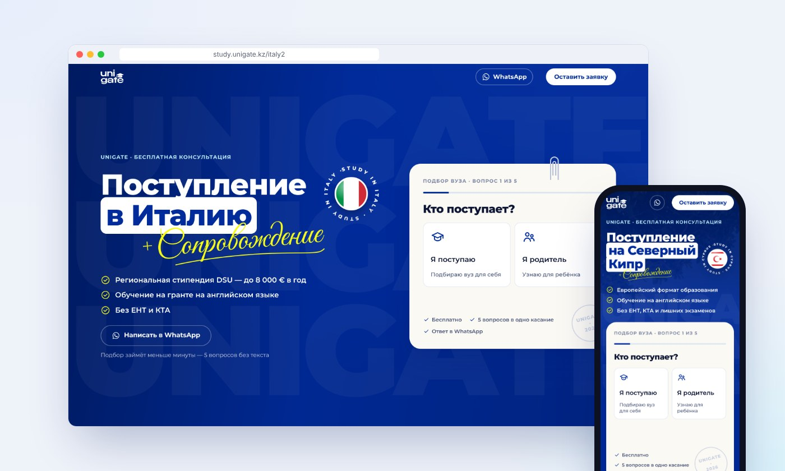
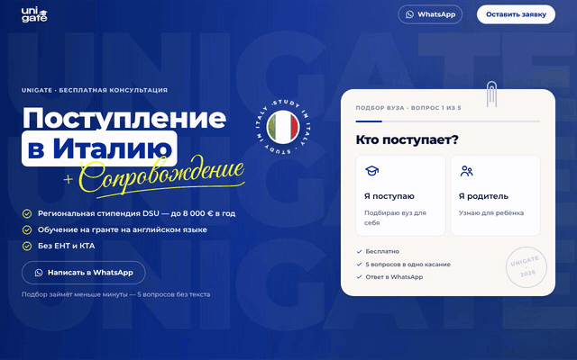
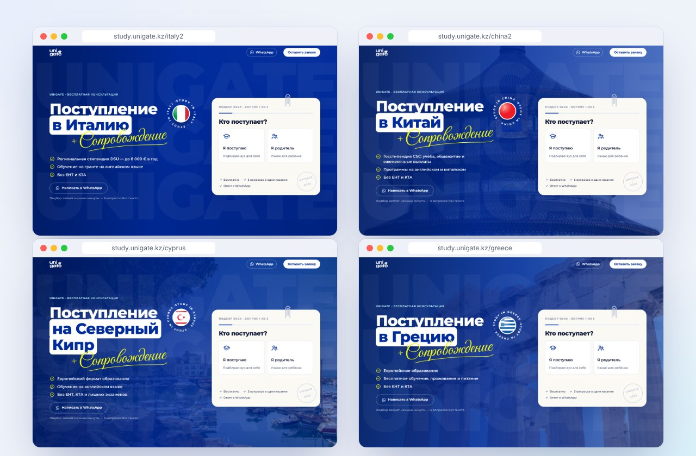
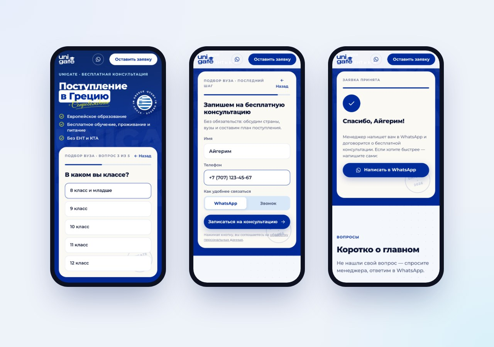
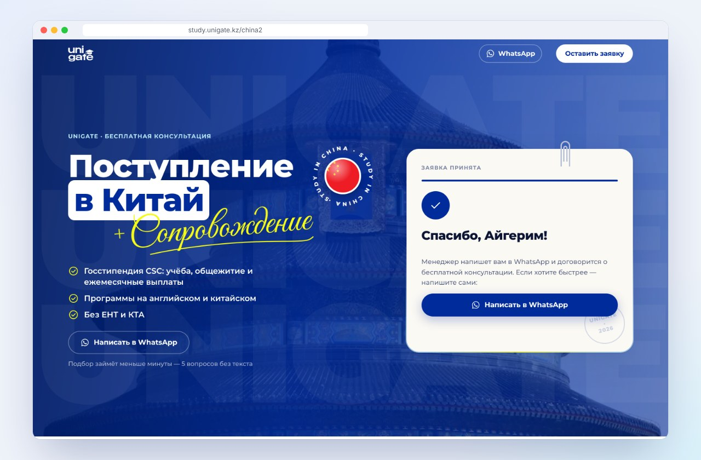
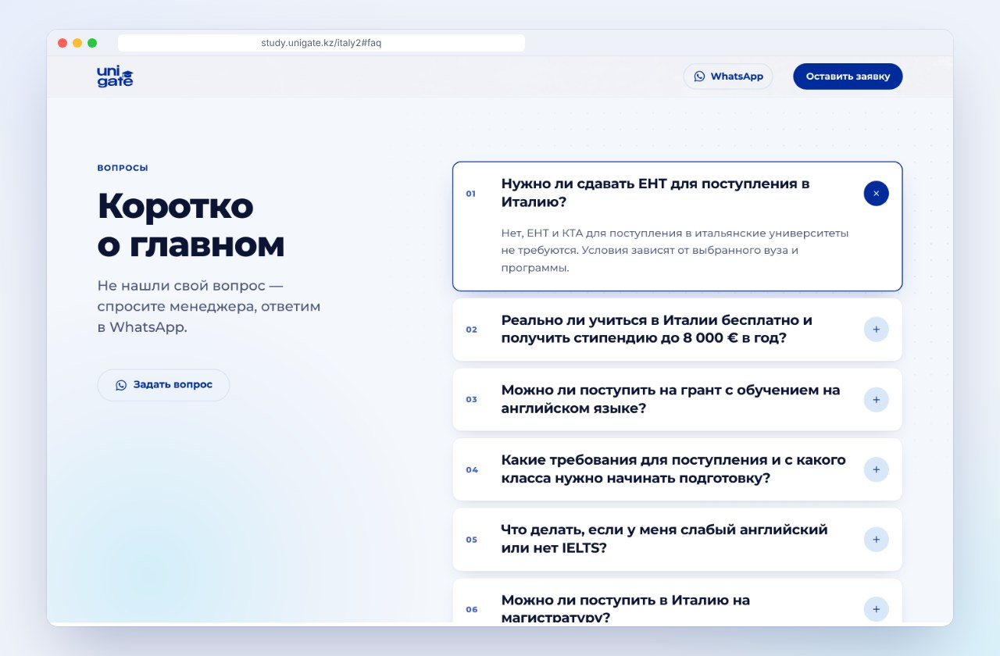
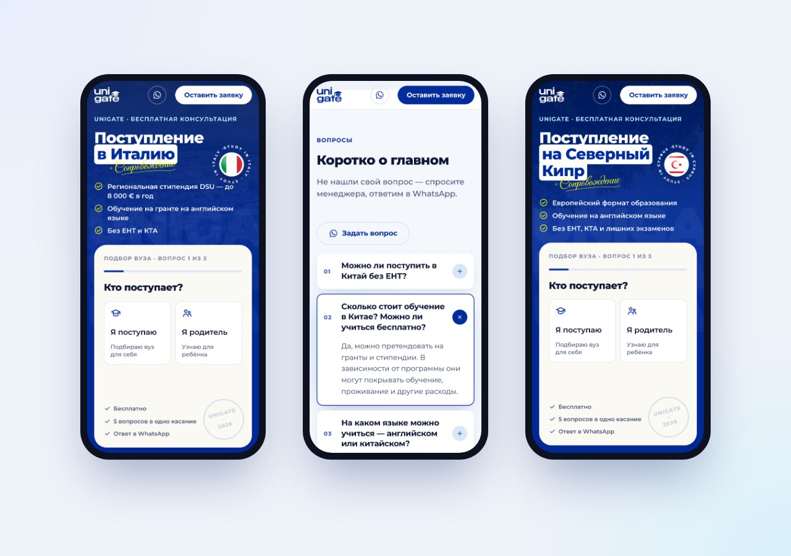
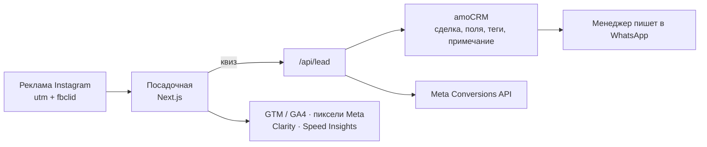

# unigate · посадочные под рекламу с квизом и amoCRM

**Реклама в Instagram → посадочная страна → квиз в 5 касаний → сделка в amoCRM с заполненными полями и метками.**
Посадочные для unigate — агентства обучения за рубежом из Алматы. Четыре страны на одном шаблоне: Италия, Китай, Северный Кипр, Греция.

🔗 **Живые страницы:** [italy2](https://study.unigate.kz/italy2) · [china2](https://study.unigate.kz/china2) · [cyprus](https://study.unigate.kz/cyprus) · [greece](https://study.unigate.kz/greece)

> Клиентский проект, код приватный. Здесь — что сделано и как устроено.
> *Client project — source code is private. This page shows what was built and how.*

## Задача

Трафик из Instagram почти весь мобильный. Человек приходит за одной страной — значит, первый экран должен сразу ответить «да, вам сюда», а заявка не должна быть анкетой. Менеджерам нужна не просто строка «имя и телефон», а готовая карточка в amoCRM: кто обращается, где учится, как планирует платить, откуда пришёл.

## Как это работает

Первый экран → вопрос «Кто поступает?» → где учится и в каком классе или на каком курсе → оплата → город → имя, телефон и способ связи → «Заявка принята».

## Что сделано

| | |
|---|---|
|  | **Четыре страны — один шаблон.** Новая посадочная — это запись в конфиге: страна, фото, флаг, три факта и свои вопросы. Шапка без разделов: человек из рекламы никуда не уходит до заявки. |
|  | **Квиз без печатания.** 5 вопросов в одно касание, ветвление по ответам (школа → класс, колледж или вуз → курс, закончил → что именно). Печатать — только имя и телефон в конце. На телефоне первый вопрос виден без прокрутки. |
|  | **Заявка → amoCRM.** Сделка и контакт (повторный номер — к тому же контакту), 8 полей карточки из ответов квиза, 9 полей отслеживания (UTM, referrer, fbclid — как на прежних страницах клиента), теги страницы и источника, примечание со ссылкой «написать в WhatsApp» в один тап. |
|  | **Вопросы по каждой стране** — свои для Италии, Китая, Кипра и Греции, тексты от клиента. |

## Как устроено

**Надёжность заявки.** Сайт ждёт ответа amoCRM и только потом пишет «Заявка принята». Не принял — человек видит кнопку WhatsApp, а заявка целиком остаётся в логах. Поле в CRM переименовали или удалили — сделка всё равно создаётся, ответ остаётся в примечании, в логе подсказка, что поправить.
**Защита от спама:** ловушка для ботов, проверка времени заполнения и источника запроса, лимит по IP, без дублей одного номера за 10 минут.
**Аналитика:** одно событие уходит во все счётчики — начало квиза, каждый шаг (видно, где отваливаются), заявка, клик в WhatsApp. Заявка в Meta — из браузера и с сервера, склеивается в одну. Записи сессий Microsoft Clarity без содержимого полей имени и телефона.
**Скорость:** функция заявки во Франкфурте — ближе к CRM; найден и убран рывок при прокрутке (Next.js заранее подгружал страницу политики посреди скролла).
**Проверка:** 34 автотеста Playwright — квиз на всех четырёх страницах, двойной тап, метки, поля CRM на заглушке amoCRM. Скриншоты на 390 / 768 / 1440 перед каждой выкладкой.

## Стек

Next.js 16 (App Router) · React 19 · TypeScript · CSS-переменные без UI-библиотек · GSAP (ScrollTrigger, SplitText) · amoCRM API v4 · Meta Pixel + Conversions API · Google Tag Manager / GA4 · Microsoft Clarity · Vercel (Speed Insights) · Playwright

---

Сделал [lightisagod](https://github.com/lightisagod) · [Telegram](https://t.me/derevo1337sol)
